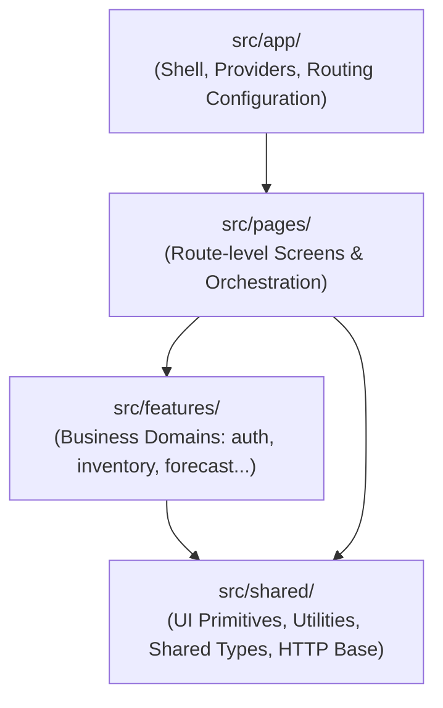

# Báo cáo Kiến trúc: Thiết lập Nền tảng Dự án ShelfCash FE v2

---

## Thông tin Báo cáo (Report Metadata)

| Trường thông tin | Giá trị |
| :--- | :--- |
| **Số thứ tự (ID)** | `#001` |
| **Tiêu đề** | Thiết lập nền tảng dự án & Định hướng kiến trúc tổng thể (Architecture Foundation) |
| **Ngày tạo lập** | 05/10/2026 |
| **Tác giả / Vai trò** | Pair Programming AI Assistant (Antigravity) & Lead Engineer |
| **Trạng thái** | Đã nghiệm thu (Accepted) |

---

## 1. General Context (Bối cảnh Tổng quan)

> Cập nhật triển khai 10/10/2026: phần mục tiêu ban đầu bên dưới là bối cảnh lịch sử. Ứng dụng hiện có Login và Import History (H01/H02), router khai báo, cấu hình môi trường tập trung và HTTP dùng `fetch`; chưa tích hợp xác thực thật.

Dự án **ShelfCash Frontend (v2)** là phiên bản làm mới hoàn toàn (rebuild from scratch) của hệ thống ShelfCash, bắt đầu từ một repository trống. 

Mục tiêu cốt lõi của giai đoạn này là:
1. **Thiết lập nền móng kỹ thuật chuẩn xác, tinh gọn**: Sử dụng React 19 + TypeScript + Vite, không mang theo các quyết định kiến trúc cũ mang tính nợ kỹ thuật (legacy technical debt).
2. **Tuân thủ triết lý tối giản (Anti-overengineering)**: Chỉ tạo những thành phần thực sự cần thiết cho yêu cầu hiện tại; không trừu tượng hóa sớm (no premature abstraction); tuyệt đối không cài đặt hàng loạt thư viện ngoại vi (Redux, Zustand, React Query, Axios, Tailwind, Component UI kits) khi chưa có bài toán cụ thể.
3. **Đáp ứng yêu cầu UI tối thiểu ban đầu**:
   - Header hiển thị chữ `ShelfCash` ở góc trên bên trái.
   - Nút `Đăng nhập` ở góc trên bên phải.
   - Căn chỉnh ngang, padding hợp lý, hỗ trợ responsive cơ bản.
   - Toàn bộ phần còn lại của màn hình để trống; không icon, không ảnh, không animation, không mock API hay logic xác thực giả.
4. **Mở đường cho kiến trúc module hóa tương lai**: Đảm bảo cấu trúc code sẵn sàng mở rộng sang các phân hệ nghiệp vụ phức tạp (Inventory, Forecasting, Procurement, v.v.) mà không cần đập đi xây lại.

---

## 2. Current Tech Stack (Công nghệ Hiện tại)

- **Framework / Core**: [React 19](https://react.dev/) (`react`, `react-dom`)
- **Ngôn ngữ**: [TypeScript](https://www.typescriptlang.org/) (Strict typing, Bundler resolution)
- **Công cụ Build & Dev Server**: [Vite 8](https://vite.dev/) (Cực nhanh, hỗ trợ HMR)
- **Styling**: Native Vanilla CSS ([`src/index.css`](../src/index.css))
- **Routing**: `react-router`, declarative `BrowserRouter` cho hai màn hình
- **Linter**: Oxlint (Kiểm tra quy tắc React & TypeScript với hiệu năng cao)

> **Ghi chú về Dependencies**: Chỉ bổ sung runtime dependency `react-router` khi có màn hình thứ hai. HTTP dùng native `fetch`; không thêm thư viện global state, HTTP, async cache hay UI.

---

## 3. Current Directory Structure (Cấu trúc Thư mục Hiện tại)

```text
Shelfcash_FE_v2/
├── docs/
│   ├── README.md                          # Thư viện quản lý các báo cáo kiến trúc
│   └── 001-architecture-foundation.md     # Báo cáo #001 này
├── public/
│   └── favicon.svg                        # Favicon tối giản của ShelfCash
├── src/
│   ├── main.tsx                           # Điểm khởi chạy React ứng dụng
│   ├── index.css                          # Reset và nền tảng CSS chung
│   ├── app/
│   │   ├── App.tsx                        # Composition root / BrowserRouter
│   │   ├── AppRouter.tsx                  # / → /login; /login; /import-history
│   │   └── config.ts                     # Kiểm tra public environment config
│   ├── pages/
│   │   ├── login/                        # LoginPage.tsx + CSS bố cục có sẵn
│   │   └── import-history/               # Page orchestration, URL state + CSS
│   ├── features/
│   │   ├── auth/                         # LoginForm.tsx + CSS; chưa gọi auth API
│   │   └── import-history/               # H01/H02 types, fixtures, data, validation,
│   │                                     # format và components lịch/danh sách
│   └── shared/http/                      # httpClient.ts + http.types.ts
├── .env.example                          # Public config mẫu; không chứa secrets
├── index.html                             # Template HTML gốc (<title>ShelfCash</title>)
├── package.json                           # Khai báo dependency và script thực thi
├── package-lock.json
├── tsconfig.json
├── tsconfig.app.json
├── tsconfig.node.json
├── vite.config.ts
└── README.md                              # Tài liệu hướng dẫn khởi chạy dự án
```

> **Đã dọn dẹp sạch sẽ**: Đã xóa toàn bộ tài nguyên mẫu mặc định sinh ra bởi Vite (`hero.png`, `react.svg`, `vite.svg`, `icons.svg`, `App.css`).

---

## 4. Architecture Direction (Định hướng Kiến trúc Dài hạn)

Dự án định hướng theo mô hình **Kiến trúc hướng tính năng (Feature-Driven / Modular Frontend Architecture)**, phân định rõ ràng 4 tầng trách nhiệm:



### Chi tiết phân chia trách nhiệm:

1. **`app/` (Application Shell & Infrastructure)**:
   - *Hiện tại:* `main.tsx` chỉ bootstrap React. `app/App.tsx` ghép router; `AppRouter.tsx` khai báo URL; `config.ts` là nơi duy nhất đọc `import.meta.env`.

2. **`pages/` (Màn hình mức Route)**:
   - *Hiện tại:* `LoginPage` ghép form có sẵn. `ImportHistoryPage` quản lý query URL (tháng/ngày/bộ lọc/cursor), local state/effects, hủy request cũ, loading/success/empty/error/retry; ghép lịch và danh sách từ feature.

3. **`features/` (Phân hệ Nghiệp vụ Độc lập)**:
   - *Hiện tại:* `auth` sở hữu form Login local, không Register/reset/auth giả. `import-history` sở hữu models, fixtures, kiểm tra response, format và data boundary H01/H02. UI dùng cùng boundary trong mock/API; lỗi API không fallback sang mock.

4. **`shared/` (Tài nguyên Dùng chung)**:
   - *Hiện tại:* Chỉ có nền HTTP/JSON envelope, `credentials: 'include'`, hủy/timeout request, phân biệt lỗi transport/HTTP/contract/protocol và nhận headers từ caller. Không có JWT/localStorage token hoặc CSRF lifecycle. Chưa tạo shared UI/design system.

### Hợp đồng và nguồn dữ liệu hiện tại

- Root `api-contract-v1/` là thẩm quyền. `IMPORT_MAPPING_API_CONTRACT_VI.md` §§3/11 giữ H01/H02 và định nghĩa FE0 §5 được dẫn chiếu; tham chiếu chỉ dùng để lấy field schema được giữ lại. ID UUID, timestamp UTC, lifecycle/filter `in_progress` áp dụng override V1, không dùng enum/ID lịch sử.
- H01: `GET /api/v1/stores/{store_id}/imports/calendar` (`month`, `category/status/q`). H02: `GET /api/v1/stores/{store_id}/imports` (`import_date`, `limit`, `sort=-imported_at`, `cursor`, cùng filters).
- Lịch nhóm theo `imported_at` trong timezone Store, không theo `data_date`. Cursor opaque, trang tiếp lấy từ `meta.pagination.next_cursor`; page không gửi `limit`, để H02 dùng mặc định backend 50 (tối đa 100). Ví dụ fixture 3 bản ghi/trang chỉ phục vụ QA. Counts `null` không thành 0; collection `null` bị báo sai contract, không biến thành `[]`. Transport giữ date/timestamp là string; hai schema này không có decimal/money fields.
- Fixtures là ví dụ tĩnh tháng 10/2026, gồm nhiều trạng thái, unknown count, phân trang, empty/error. Bộ lọc chỉ chọn trong tập ví dụ; không có fake server hoặc nghiệp vụ upload/commit.
- Cấu hình và cách chuyển mode xem README. `VITE_DEV_STORE_ID` là UUID Store public để kiểm tra API trong khi chưa có Store selection, không phải cấp quyền. Backend vẫn phải xác thực session/Store access.
- READY ở mức thiết kế không chứng minh API đã triển khai: business HTTP chưa được xác minh; chỉ `/health` có bằng chứng. API mode có thể hiển thị lỗi bình thường.

---

## 5. Quy hoạch Vị trí các Phân hệ Tương lai (Future Modules)

Khi phát triển thêm tính năng, code sẽ được đưa vào các thư mục tương ứng trong `src/features/`:

| Phân hệ (Module) | Đường dẫn dự kiến | Phạm vi trách nhiệm |
| :--- | :--- | :--- |
| **Authentication** | `src/features/auth/` | Hiện chỉ form Login; sau này session cookie HttpOnly và A01/A03/A04, không token storage |
| **Dashboard** | `src/features/dashboard/` | Widget tổng quan, KPI metrics, biểu đồ tóm tắt hiệu suất |
| **Inventory** | `src/features/inventory/` | Danh mục hàng tồn, SKU, số lượng theo kho, điều chỉnh tồn kho |
| **Forecasting** | `src/features/forecasting/` | Biểu đồ dự báo nhu cầu, phân tích xu hướng bán hàng, dự đoán theo mùa |
| **Decision Planning** | `src/features/decision-planning/`| Đề xuất nhập hàng, kế hoạch đặt hàng tự động, mô phỏng ngân sách |
| **Procurement** | `src/features/procurement/` | Đơn đặt hàng (PO), quản lý nhà cung cấp, tiến độ giao hàng |

---

## 6. What NOT to add yet (Những hạng mục chủ động hoãn lại)

Để bảo đảm tính đơn giản và tránh nợ kỹ thuật từ sớm, các hạng mục sau **chưa được thêm vào**:
- **Global State Management (Redux, Zustand, Jotai)**: Chưa có nhu cầu chia sẻ state liên màn hình.
- **Axios, React Query, Mock Backend**: Native fetch + local state đủ cho H01/H02; không thêm server giả hoặc async framework.
- **Routing phức tạp / auth guards**: Hai route dùng declarative router; `/import-history` cố ý truy cập trực tiếp, không giả trạng thái đăng nhập.
- **AuthProvider, session bootstrap, CSRF lifecycle, Store switcher, permission gating, upload/mapping/commit**: Chưa thuộc milestone này. A02 self-registration DEFERRED; không có public reset-initiation route.
- **Design System / Token System / Tailwind**: Đang sử dụng CSS tinh gọn; hệ thống design token sẽ chỉ hình thành khi UI guideline hoàn thiện.
- **Component UI Kit (Ant Design, MUI, Shadcn)**: Tránh làm phình bundle size và ràng buộc giao diện vào thư viện bên ngoài.

---

## 7. Next Architectural Milestone (Cột mốc Kiến trúc Tiếp theo)

Router, hai màn hình và boundary dữ liệu đầu tiên đã có. Chỉ triển khai auth/session/Store khi A01/A03/A04/T01/T02 có implementation evidence và được giao milestone riêng; không mở thêm module rỗng lúc này.

---

## 8. Kết quả Xác minh Kỹ thuật (Validation)

Milestone 10/10/2026:

- **Build/Lint**: `npm run build` và `npm run lint` thành công, không lỗi/cảnh báo.
- **Chrome kiểm tra local**: direct URL, redirect gốc, refresh, Back/Forward, điều hướng Link không reload; Login validation/show password, không request auth.
- **History**: loading/success/empty/error/retry, cursor, bộ lọc cùng file, ngày theo Store timezone, unknown counts; kiểm tra responsive 320/390/768/1024/1440 px không overflow ngang và xem ảnh chụp desktop/mobile.
- **Mock/API**: fixtures tải đúng; API mode gọi H01/H02 thật và báo lỗi khi backend không kết nối được, không fallback. Response success/401/sai schema được kiểm bằng browser interception chỉ trong QA, không fake server trong ứng dụng và không chứng minh backend đã triển khai.
- **Foundation**: kiểm tra config invalid/default/normalization, JSON/cookies/headers và phân loại lỗi HTTP; không thêm dependency kiểm thử vào repo.
