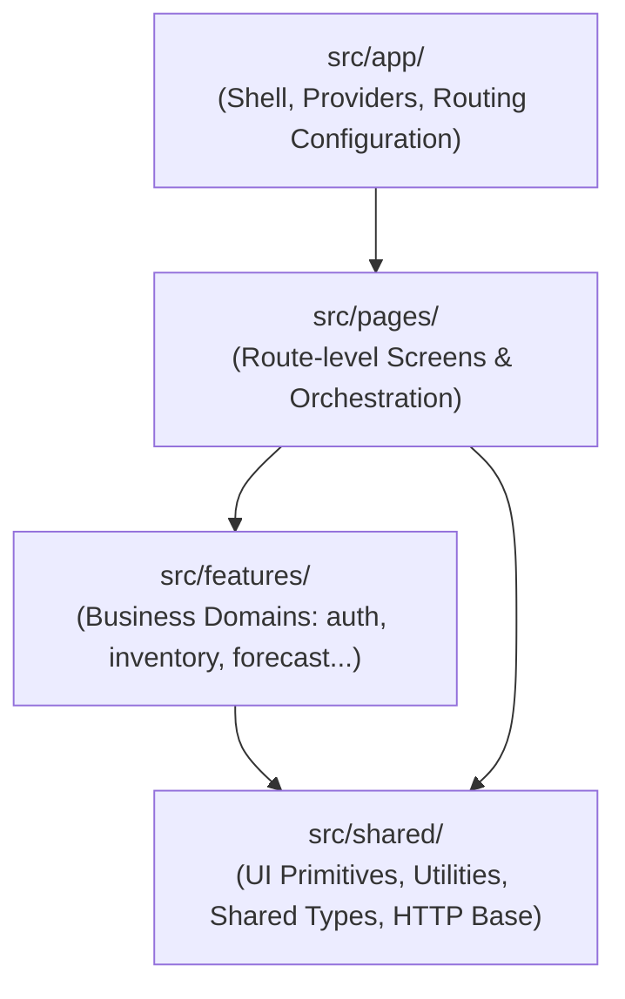

# Báo cáo Kiến trúc: Thiết lập Nền tảng Dự án ShelfCash FE v2

---

## Thông tin Báo cáo (Report Metadata)

| Trường thông tin | Giá trị |
| :--- | :--- |
| **Số thứ tự (ID)** | `#001` |
| **Tiêu đề** | Thiết lập nền tảng dự án & Định hướng kiến trúc tổng thể (Architecture Foundation) |
| **Ngày tạo lập** | 05/10/2026 |
| **Tác giả / Vai trò** | Pair Programming AI Assistant (Antigravity) & Lead Engineer |
| **Trạng thái** | Đã nghiệm thu (Accepted) |

---

## 1. General Context (Bối cảnh Tổng quan)

> Cập nhật triển khai 10/10/2026: phần mục tiêu ban đầu bên dưới là bối cảnh lịch sử. Ứng dụng hiện có Login độc lập, workspace Import (chọn file local, HDSD, H01/H02), Kho chỉ đọc (V01–V04) và Menu/công thức chỉ đọc (P01/P02) trong AppShell. Router khai báo, cấu hình môi trường tập trung và HTTP dùng `fetch` được giữ nguyên; chưa tích hợp xác thực, upload hay business backend thật.

Dự án **ShelfCash Frontend (v2)** là phiên bản làm mới hoàn toàn (rebuild from scratch) của hệ thống ShelfCash, bắt đầu từ một repository trống. 

Mục tiêu cốt lõi của giai đoạn này là:
1. **Thiết lập nền móng kỹ thuật chuẩn xác, tinh gọn**: Sử dụng React 19 + TypeScript + Vite, không mang theo các quyết định kiến trúc cũ mang tính nợ kỹ thuật (legacy technical debt).
2. **Tuân thủ triết lý tối giản (Anti-overengineering)**: Chỉ tạo những thành phần thực sự cần thiết cho yêu cầu hiện tại; không trừu tượng hóa sớm (no premature abstraction); tuyệt đối không cài đặt hàng loạt thư viện ngoại vi (Redux, Zustand, React Query, Axios, Tailwind, Component UI kits) khi chưa có bài toán cụ thể.
3. **Đáp ứng yêu cầu UI tối thiểu ban đầu**:
   - Header hiển thị chữ `ShelfCash` ở góc trên bên trái.
   - Nút `Đăng nhập` ở góc trên bên phải.
   - Căn chỉnh ngang, padding hợp lý, hỗ trợ responsive cơ bản.
   - Toàn bộ phần còn lại của màn hình để trống; không icon, không ảnh, không animation, không mock API hay logic xác thực giả.
4. **Mở đường cho kiến trúc module hóa tương lai**: Đảm bảo cấu trúc code sẵn sàng mở rộng sang các phân hệ nghiệp vụ phức tạp (Inventory, Forecasting, Procurement, v.v.) mà không cần đập đi xây lại.

---

## 2. Current Tech Stack (Công nghệ Hiện tại)

- **Framework / Core**: [React 19](https://react.dev/) (`react`, `react-dom`)
- **Ngôn ngữ**: [TypeScript](https://www.typescriptlang.org/) (Strict typing, Bundler resolution)
- **Công cụ Build & Dev Server**: [Vite 8](https://vite.dev/) (Cực nhanh, hỗ trợ HMR)
- **Styling**: Native Vanilla CSS ([`src/index.css`](../src/index.css))
- **Routing**: `react-router`, declarative `BrowserRouter` với nested internal routes trong AppShell
- **Linter**: Oxlint (Kiểm tra quy tắc React & TypeScript với hiệu năng cao)

> **Ghi chú về Dependencies**: Chỉ bổ sung runtime dependency `react-router` khi có màn hình thứ hai. HTTP dùng native `fetch`; không thêm thư viện global state, HTTP, async cache hay UI.

---

## 3. Current Directory Structure (Cấu trúc Thư mục Hiện tại)

```text
Shelfcash_FE_v2/
├── docs/
│   ├── README.md                          # Thư viện quản lý các báo cáo kiến trúc
│   └── 001-architecture-foundation.md     # Báo cáo #001 này
├── public/
│   └── favicon.svg                        # Favicon tối giản của ShelfCash
├── src/
│   ├── main.tsx                           # Điểm khởi chạy React ứng dụng
│   ├── index.css                          # Reset và nền tảng CSS chung
│   ├── app/
│   │   ├── App.tsx                        # Composition root / BrowserRouter
│   │   ├── AppRouter.tsx                  # Login + /imports + /inventory + /menu; legacy redirect
│   │   └── config.ts                     # Kiểm tra public environment config
│   ├── layouts/app-shell/                # AppShell.tsx + CSS, Sidebar.tsx; Outlet
│   ├── pages/
│   │   ├── login/                        # LoginPage.tsx + CSS bố cục có sẵn
│   │   ├── imports/                      # ImportPage.tsx + CSS; ImportWorkspace.tsx
│   │   ├── import-history/               # Page orchestration, URL state + CSS
│   │   ├── inventory/                    # InventoryPage.tsx + CSS; composition/URL state
│   │   └── menu/                         # MenuPage.tsx + CSS; composition/URL state
│   ├── features/
│   │   ├── auth/                         # LoginForm.tsx + CSS; chưa gọi auth API
│   │   ├── import-data/                  # importData.files.ts; ImportUpload/ImportHelp + CSS
│   │   ├── import-history/               # H01/H02 types, fixtures, data, validation,
│   │   │                                 # format và components lịch/danh sách
│   │   ├── inventory/                    # V01–V04 types/data/validation/format/fixtures;
│   │   │                                 # components/InventoryTable.tsx, InventoryDetail.tsx
│   │   └── menu/                         # P01/P02 types/data/validation/format/fixtures;
│   │                                     # components/MenuTable.tsx, MenuDetail.tsx
│   └── shared/http/                      # httpClient.ts + http.types.ts
├── .env.example                          # Public config mẫu; không chứa secrets
├── index.html                             # Template HTML gốc (<title>ShelfCash</title>)
├── package.json                           # Khai báo dependency và script thực thi
├── package-lock.json
├── tsconfig.json
├── tsconfig.app.json
├── tsconfig.node.json
├── vite.config.ts
└── README.md                              # Tài liệu hướng dẫn khởi chạy dự án
```

> **Đã dọn dẹp sạch sẽ**: Đã xóa toàn bộ tài nguyên mẫu mặc định sinh ra bởi Vite (`hero.png`, `react.svg`, `vite.svg`, `icons.svg`, `App.css`).

---

## 4. Architecture Direction (Định hướng Kiến trúc Dài hạn)

Dự án định hướng theo mô hình **Kiến trúc hướng tính năng (Feature-Driven / Modular Frontend Architecture)**, phân định rõ ràng 4 tầng trách nhiệm:



### Chi tiết phân chia trách nhiệm:

1. **`app/` (Application Shell & Infrastructure)**:
   - *Hiện tại:* `main.tsx` chỉ bootstrap React. `app/App.tsx` ghép router; `AppRouter.tsx` khai báo URL; `config.ts` là nơi duy nhất đọc `import.meta.env`.
   - `layouts/app-shell/` sở hữu sidebar, navigation active theo URL, header dùng chung, responsive layout và Outlet; không giữ auth, Store hay logic domain. `/login` ở ngoài shell. `/imports`, `/imports/history`, `/inventory` và `/menu` nằm trong shell; `/import-history` redirect giữ query/hash. Nhập dữ liệu, Kho và Menu có link thật; các mục chưa triển khai vẫn disabled.
   - Internal routes **tạm thời không bảo vệ để phát triển FE**, không phải cơ chế bảo mật production. AuthGuard tương lai phải nằm **ngoài AppShell**: Router → AuthGuard → AppShell → page; không thêm guard giả lúc này.

2. **`pages/` (Màn hình mức Route)**:
   - *Hiện tại:* `LoginPage` ghép form có sẵn. `ImportPage` ghép upload UI, ngày dữ liệu local, shortcut History và state mở/đóng HDSD; File mẫu và xử lý dữ liệu vẫn disabled. `ImportWorkspace` giữ File[]/ngày trong React state qua Outlet context khi đi giữa hai trang; không persist, refresh/rời workspace sẽ mất selection, không cần global state library/provider.
   - `ImportHistoryPage` quản lý query URL (tháng/ngày/bộ lọc/cursor), local state/effects, hủy request cũ, loading/success/empty/error/retry; ghép lịch và danh sách từ feature. Breadcrumb quay về Import dùng Router Link, không reload.
   - `InventoryPage` quản lý URL q/status/cursor/ingredient, V01 loading/success/empty/error/retry và chọn nguyên liệu. Search/status dùng đúng query V1; đổi bộ lọc bỏ cursor/chi tiết cũ. Không có InventoryProvider/global store. Chi tiết được mount theo ingredient + snapshot, hủy read cũ; lỗi snapshot khiến cả bảng và drawer bị vô hiệu, tải lại bắt đầu từ trang đầu.
   - `MenuPage` quản lý URL q/status/cursor/product, P01 loading/success/empty/error/retry và chọn món. Search chỉ tên món, status active/paused; đổi bộ lọc xóa cursor/chi tiết, trang tiếp giữ query. Panel không modal, focus/Escape trả về món đã chọn; hủy reads cũ. Version/ngày/timezone khác giữa các trang hoặc P01/P02 làm vô hiệu tập đang hiển thị và yêu cầu tải lại; không thêm snapshot query mà P02 không hỗ trợ. Không MenuProvider/global store.

3. **`features/` (Phân hệ Nghiệp vụ Độc lập)**:
   - *Hiện tại:* `auth` sở hữu form Login local, không Register/reset/auth giả. `import-data` sở hữu picker/drop, danh sách file, remove/clear và kiểm tra sơ bộ **toàn bộ danh sách chọn dự kiến** (file hiện có + file thêm mới). Import §6: chỉ kiểm tra phần mở rộng .csv/.xlsx; tối đa **20 files per batch, 20 MiB per file, 100 MiB total compressed bytes per batch** (inclusive, cộng `File.size` trước giải nén, không phải dung lượng XLSX đã giải nén). Từ chối toàn bộ lần thêm không hợp lệ, giữ nguyên selection cũ. Extension không chứng minh nội dung hợp lệ; sniffing/parser và canonical batch truth qua các upload calls thuộc I01/I02 tương lai, phải tính cả file backend đã chấp nhận, không chỉ file trong bộ nhớ FE. Chưa upload, tạo batch hay analyze/mapping/commit.
   - `import-history` sở hữu models, fixtures, kiểm tra response, format và data boundary H01/H02. UI dùng cùng boundary trong mock/API; lỗi API không fallback sang mock.
   - `inventory` sở hữu DTO/boundary V01–V04, validation runtime, fixtures chỉ đọc, format exact string và bảng/drawer lô/biến động. V02 chứa summary nguyên liệu + trang lô đầu; V03/V04 pin snapshot V01 và kiểm tra ngày/data_version trước khi ghép trang. Không tái dùng H01/H02 làm movement history, không dựng balance từ movements gần đây. `use_first` chỉ hiển thị cờ backend, không chạy FEFO hay ghi USAGE.
   - `menu` sở hữu DTO/boundary P01/P02, validation runtime, fixtures tĩnh, format decimal/money không qua Number và bảng/panel công thức. Product, Recipe/version, RecipeLine và Ingredient có UUID riêng; names không làm identity. Recipe không bị thay bằng inventory/BOM execution, quantity mỗi line cho toàn yield, unit=base_unit và yield_unit=selling_unit exact. Null recipe khác empty lines; null/forbidden count khác0. Không gọi Inventory từ Menu hoặc tạo trạng thái lưu giả.
   - `ImportHelp` trong `features/import-data/components` sở hữu nội dung HDSD tĩnh và native modal drawer, bám tương tác MagicPath chỉ đọc; không tạo route/hook/provider/library mới. Nội dung dựa Import Contract V1 §§5 (bố cục/ngày/số/đơn vị), 6 (nhóm dữ liệu/giới hạn), 9.1 (ngày ngữ cảnh và xác minh nội dung tương lai), 13 (phạm vi supplier). Không đặt bộ cột bắt buộc, quy tắc một dòng header hay quảng cáo import lịch sử nhập hàng/Excel supplier bất kỳ. Đây không phải parser, schema detector hoặc upload flow; nợ canonical server batch validation tại [TODO §E](./002-technical-debt-and-integration-todo.md#e-import-upload-contract-validation) giữ nguyên.

4. **`shared/` (Tài nguyên Dùng chung)**:
   - *Hiện tại:* Chỉ có nền HTTP/JSON envelope, `credentials: 'include'`, hủy/timeout request, phân biệt lỗi transport/HTTP/contract/protocol và nhận headers từ caller. Không có JWT/localStorage token hoặc CSRF lifecycle. Chưa tạo shared UI/design system.

### Hợp đồng và nguồn dữ liệu hiện tại

- Root `api-contract-v1/` là thẩm quyền. `IMPORT_MAPPING_API_CONTRACT_VI.md` §§3/11 giữ H01/H02 và định nghĩa FE0 §5 được dẫn chiếu; tham chiếu chỉ dùng để lấy field schema được giữ lại. ID UUID, timestamp UTC, lifecycle/filter `in_progress` áp dụng override V1, không dùng enum/ID lịch sử.
- H01: `GET /api/v1/stores/{store_id}/imports/calendar` (`month`, `category/status/q`). H02: `GET /api/v1/stores/{store_id}/imports` (`import_date`, `limit`, `sort=-imported_at`, `cursor`, cùng filters).
- Lịch nhóm theo `imported_at` trong timezone Store, không theo `data_date`. Cursor opaque, trang tiếp lấy từ `meta.pagination.next_cursor`; page không gửi `limit`, để H02 dùng mặc định backend 50 (tối đa 100). Ví dụ fixture 3 bản ghi/trang chỉ phục vụ QA. Counts `null` không thành 0; collection `null` bị báo sai contract, không biến thành `[]`. Transport giữ date/timestamp là string; hai schema này không có decimal/money fields.
- Fixtures là ví dụ tĩnh tháng 10/2026, gồm nhiều trạng thái, unknown count, phân trang, empty/error. Bộ lọc chỉ chọn trong tập ví dụ; không có fake server hoặc nghiệp vụ upload/commit.
- Cấu hình và cách chuyển mode xem README. `VITE_DEV_STORE_ID` là UUID Store public để kiểm tra API trong khi chưa có Store selection, không phải cấp quyền. Backend vẫn phải xác thực session/Store access.
- READY ở mức thiết kế không chứng minh API đã triển khai: business HTTP chưa được xác minh; chỉ `/health` có bằng chứng. API mode có thể hiển thị lỗi bình thường.

### Kho: nguồn authority và semantics

- MagicPath chỉ đọc: `ShelfCash · Kho · Tồn kho hiện tại`, component `458590758262427648`, revision `458596566140329984`. Giữ grayscale, toolbar/bảng, drawer phải, tabs Lô hàng/Biến động và responsive cuộn nội bộ. Không sao chép dữ liệu/location giả hoặc AI ví dụ từ prototype.
- Root `INVENTORY_API_CONTRACT_VI.md` §§2–3/6, PLAN §2 và CAT §5 là authority. GET `/api/v1/stores/{store_id}/inventory`, `/{ingredient_id}`, `/{ingredient_id}/lots`, `/{ingredient_id}/movements`; không thêm query/filter chưa chốt. Page không đặt limit/lot_limit; V04 sort `-occurred_at`. Snapshot là token optimistic hiện hành, không historical copy; 409 `SNAPSHOT_NOT_AVAILABLE` phải refresh toàn bộ tập đọc.
- `on_hand_quantity` là tồn vật lý ghi nhận (gồm expired); `usable_quantity=null` không thành0; phần biết giữ `usable_known_quantity`. Recorded0 + completenessUNKNOWN khác xác nhận tồn thực tế0. Lot ID khác mã lô nullable/nonunique. Không tự gom/hủy expiry evidence, đổi unit hoặc tính lại trạng thái theo forecast.
- QuantityText/SignedQuantity giữ string exact, format không qua Number. Business date/as_of/expiry/received giữ date-only; timestamp UTC Z tạm hiển thị nhãn UTC vì chưa có timezone từ Store context. Đây là hạn chế tích hợp cần thay bằng timezone T02 thật, không giả browser timezone/Store timezone. Location bắt buộc null/unsupported; cost masking known/unknown/forbidden được validate, không suy giá trị.
- V01 summary toàn Store không bị thay bằng counts của kết quả lọc/trang. Mock chỉ chọn/lọc/phân trang tập ví dụ tĩnh; API dùng HTTP chung, validate JSON/enums/dates/decimals/pagination/snapshot và hiển thị lỗi thật, không fallback. Inventory FE foundation **không phải** inventory HTTP verified trong production.

### Menu: nguồn authority và semantics

- MagicPath chỉ đọc: `ShelfCash · Menu · Món và công thức`, component `458614109248847872`, revision `458616728595894272`. Giữ grayscale, mật độ bảng, summary, tìm tên/lọc trạng thái và panel phải. AI bị disabled; “Xem tồn kho nguyên liệu” bị disabled vì chưa có adapter route Kho nhận tập ingredient IDs/quyền thật, không điều hướng đến Kho không lọc để giả đúng phạm vi.
- Root CAT §§4–8, PLAN §2, AUTH current V1 và aggregate §1 là authority; references không thay V1. P01 GET `/api/v1/stores/{store_id}/products` nhận q/status/limit/cursor/sort; q không tìm SKU hoặc nguyên liệu. Page sort name, không gửi limit. Backend lọc tập canonical trước keyset pagination; mock lọc toàn fixture trước slice. Summary toàn Store, total_count riêng cho toàn kết quả lọc. Cursor gắn Store/filter/sort/version; 409 LIST_VERSION_CHANGED bắt đầu lại.
- P02 GET `/api/v1/stores/{store_id}/products/{product_id}` không body/query. Server chọn recipe bao phủ as_of_date theo timezone Store, dates inclusive; không chọn max version hoặc recipe gần nhất. Lines trả đủ, không phân trang. DTO giữ recipe_id/version, from/to, yield/loss và ingredient/line IDs; UI metadata bám thiết kế hiện tại, không thêm version selector/timeline. Recipe null/missing khác header với lines=[]/known empty; price null khác0; count forbidden không được suy ra0.
- QuantityText/PositiveQuantityText/LossRateText giữ exact string; MoneyText có bounds riêng và currency từ Store. Canonical units là string, không enum cố định/alias conversion. Menu timestamp dùng meta.timezone từ P01/P02, không browser-local; updated_at null không thay bằng observed_at. Nợ Store context/timezone của Kho và auth vẫn giữ nguyên.
- P01/P02 vẫn DESIGN ONLY phía public backend. N20–N22 **đã có contract** đổi hiệu lực từ ngày Store kế tiếp, không generic CRUD; chưa có tương tác timeline/editor/preview/commit trong MagicPath Menu này nên không thực hiện. Không fake edit/save, pricing/profit, tồn đủ bán, forecast hoặc procurement. Xem [TODO §K](./002-technical-debt-and-integration-todo.md#k-menu--recipe-integration-maturity).

---

## 5. Quy hoạch Vị trí các Phân hệ Tương lai (Future Modules)

Khi phát triển thêm tính năng, code sẽ được đưa vào các thư mục tương ứng trong `src/features/`:

| Phân hệ (Module) | Đường dẫn dự kiến | Phạm vi trách nhiệm |
| :--- | :--- | :--- |
| **Authentication** | `src/features/auth/` | Hiện chỉ form Login; sau này session cookie HttpOnly và A01/A03/A04, không token storage |
| **Dashboard** | `src/features/dashboard/` | Widget tổng quan, KPI metrics, biểu đồ tóm tắt hiệu suất |
| **Inventory** | `src/features/inventory/` | Đã có Kho chỉ đọc: snapshot, tồn ghi nhận/dùng được, bằng chứng lô và movements V01–V04; chưa có mutation/location model |
| **Forecasting** | `src/features/forecasting/` | Biểu đồ dự báo nhu cầu, phân tích xu hướng bán hàng, dự đoán theo mùa |
| **Decision Planning** | `src/features/decision-planning/`| Đề xuất nhập hàng, kế hoạch đặt hàng tự động, mô phỏng ngân sách |
| **Procurement** | `src/features/procurement/` | Đơn đặt hàng (PO), quản lý nhà cung cấp, tiến độ giao hàng |

---

## 6. What NOT to add yet (Những hạng mục chủ động hoãn lại)

Để bảo đảm tính đơn giản và tránh nợ kỹ thuật từ sớm, các hạng mục sau **chưa được thêm vào**:
- **Global State Management (Redux, Zustand, Jotai)**: Selection chỉ chia sẻ trong hai route Import, React state ở parent route đủ; chưa cần app-wide store.
- **Axios, React Query, Mock Backend**: Native fetch + local state đủ cho H01/H02/V01–V04/P01/P02; không thêm server giả hoặc async framework.
- **Routing phức tạp / auth guards**: Nested routes dùng declarative router; `/imports`, `/imports/history`, `/inventory` và `/menu` cố ý truy cập trực tiếp, không giả trạng thái đăng nhập.
- **AuthProvider, session bootstrap, CSRF lifecycle, Store switcher, permission gating, upload/mapping/commit**: Chưa thuộc milestone này. A02 self-registration DEFERRED; không có public reset-initiation route.
- **Design System / Token System / Tailwind**: Đang sử dụng CSS tinh gọn; hệ thống design token sẽ chỉ hình thành khi UI guideline hoàn thiện.
- **Component UI Kit (Ant Design, MUI, Shadcn)**: Tránh làm phình bundle size và ràng buộc giao diện vào thư viện bên ngoài.

---

## 7. Next Architectural Milestone (Cột mốc Kiến trúc Tiếp theo)

Router, AppShell, Import workspace local và boundary H01/H02 đã có. Chỉ triển khai auth/session/Store hay upload workflow khi có implementation evidence và được giao milestone riêng; không mở thêm module rỗng lúc này. Khi tích hợp auth thật, phải thay routing development-accessible bằng AuthGuard ngoài shell trước khi phát hành production.

---

## 8. Kết quả Xác minh Kỹ thuật (Validation)

Milestone 03, 10/10/2026:

- **Build/Lint**: `npm run build` và `npm run lint` thành công, không lỗi/cảnh báo.
- **Chrome kiểm tra local**: direct URL, redirect gốc, legacy redirect giữ query/hash, refresh, Back/Forward, Link không reload; sidebar active/collapse theo route. Login vẫn độc lập, không thêm request auth.
- **Import local**: picker bằng bàn phím, chọn lại cùng file, drop/nested drag, reject cả nhóm file không hợp lệ và giữ selection cũ, remove/clear, giới hạn inclusive; File[]/ngày giữ qua Import ↔ History, refresh reset; không phát sinh API request.
- **History**: loading/success/empty/error/retry, cursor, bộ lọc cùng file, ngày theo Store timezone, unknown counts; kiểm tra responsive 320/390/768/1024/1440 px không overflow ngang và xem ảnh chụp desktop/mobile.
- **Mock/API**: fixtures tải đúng; API mode dùng boundary H01/H02, không fallback khi lỗi. Success/401/sai schema/network failure được kiểm bằng browser interception chỉ trong QA, không fake server trong ứng dụng và không chứng minh backend đã triển khai. Cả 17 request H02 trong kiểm tra cursor/Back/Forward/refresh/retry đều không gửi `limit`; limit 3 chỉ gọi trực tiếp trong QA.
- **Foundation**: kiểm tra config invalid/default/normalization, JSON/cookies/headers và phân loại lỗi HTTP; không thêm dependency kiểm thử vào repo.

Bổ sung HDSD, 10/10/2026: build/lint/diff check đạt; kiểm tra Chrome local xác nhận mở/đóng bằng chuột và bàn phím, Escape, trả focus về HDSD, background inert, cuộn nội dung và không overflow ngang tại 320/390/768/1440 px. File/ngày và validation được giữ khi đọc hướng dẫn; Import ↔ History, legacy redirect và Login không đổi. Nội dung tĩnh không phát sinh API request; không phải bằng chứng backend hoạt động.

Bổ sung Kho, 10/10/2026:

- `npm run build`, `npm run lint`, `git diff --check` đạt; không thêm dependency.
- 14 nhóm QA boundary xác nhận DTO V01–V04/fixtures, decimal exact cả ngoài safe Number, null/0, ngày thực/UTC, signed negative-zero, enum/field bắt buộc, duplicate/page overflow, cost masking/location, snapshot/identity, cursor scope và hủy request. Trang nhỏ chỉ được gọi trực tiếp trong QA, không thành cấu hình page.
- 13 nhóm QA Chrome local xác nhận direct URL/refresh/Sidebar/Back/Forward, loading/success/empty/error/retry, search không dấu/SKU/status và summary unfiltered, drawer lô/biến động sáu loại, tabs bàn phím/focus/Escape, unknown/expired/expiry-day/+7, responsive 320/390/768/1440 và xem ảnh chụp desktop/mobile. Bảng cuộn nội bộ khi cần, không overflow ngang toàn trang.
- API-mode QA dùng interception trong browser context riêng: 39 request Inventory đều GET, không gửi `limit`/`lot_limit`; V02/V03/V04 pin snapshot, V04 sort canonical, V03 không invent sort/filter. Xác nhận continuation, 401/network/sai JSON schema/retry/no fallback, 409 snapshot và data_version mismatch vô hiệu cả tập, unit mismatch không được ghép. Không phải live HTTP/backend acceptance.
- Hồi quy: picker 12 file rồi drop thêm10 bị reject toàn nhóm và giữ12; HDSD, Import ↔ History giữ selection, legacy redirect giữ query/hash, Login ngoài shell. H02 vẫn không gửi limit; không mở lại issue production `limit=3`. Không phát sinh API trong mock hoặc request ghi dữ liệu.

Bổ sung Menu, 10/10/2026:

- `npm run build`, `npm run lint`, `git diff --check` đạt; không thêm dependency.
- 18 nhóm QA boundary xác nhận P01/P02/fixtures, UUID và nullable fields, MoneyText có bounds riêng, quantity/yield/loss exact string, recipe version/ngày hiệu lực inclusive, canonical units, thứ tự/uniqueness lines, count redaction, ngày/UTC timestamp/IANA timezone, pagination/cursor scope và hủy request. Search tên không dấu lọc toàn fixture trước phân trang; trang nhỏ chỉ gọi trực tiếp trong QA.
- 14 nhóm QA Chrome local xác nhận direct `/menu`, Sidebar/refresh/Back/Forward, loading/success/Store-empty/filtered-empty/error/retry, status/name-only search và Store-wide summary, detail thiếu/empty recipe, null/zero price, inactive ingredient, toàn yield và ngày hiệu lực. Keyboard/Escape/focus restoration, labels/tables, disabled actions và responsive 320/390/768/1440 đạt; đã xem ảnh desktop/mobile, cả tên dài và decimal dài. Bảng cuộn nội bộ, panel vẫn sử dụng được và không overflow ngang toàn trang kể cả lúc mở.
- API-mode QA dùng interception trong browser context riêng: dataset 500 món với trang 50 tìm được món ở vị trí 271, query đổi xóa cursor và continuation giữ bộ lọc. Cả 67 request Menu của lần chạy cuối đều GET, không gửi `limit`; P02 không body/query. Kiểm tra 401/403/network/503/sai schema/timezone, retry/no fallback, 409 và version/ngày/count mismatch vô hiệu cả read set. Không gọi Inventory từ Menu; đây không phải live HTTP/backend acceptance.
- Chạy lại 13 nhóm QA hồi quy Kho V01–V04, query/cursor/snapshot/errors, responsive/keyboard cùng Import picker/drop giữ selection, HDSD, History/legacy redirect và Login. Cả 39 request Inventory đều GET, không gửi `limit`/`lot_limit`; H02 vẫn không gửi `limit`. Mock không phát sinh API request; không có browser error hay mutation request.
