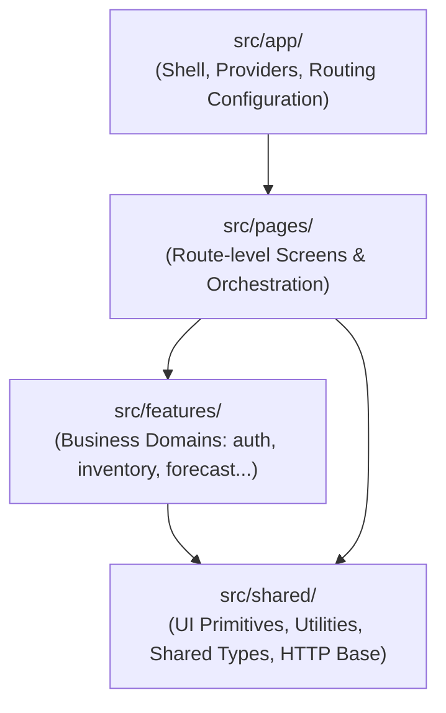

# Báo cáo Kiến trúc: Thiết lập Nền tảng Dự án ShelfCash FE v2

---

## Thông tin Báo cáo (Report Metadata)

| Trường thông tin | Giá trị |
| :--- | :--- |
| **Số thứ tự (ID)** | `#001` |
| **Tiêu đề** | Thiết lập nền tảng dự án & Định hướng kiến trúc tổng thể (Architecture Foundation) |
| **Ngày tạo lập** | 05/10/2026 |
| **Tác giả / Vai trò** | Pair Programming AI Assistant (Antigravity) & Lead Engineer |
| **Trạng thái** | Đã nghiệm thu (Accepted) |

---

## 1. General Context (Bối cảnh Tổng quan)

> Milestone10, 11/10/2026: `/store` uses current MagicPath Store design inside AuthGuard → StoreProvider → AppShell; only business routes require StoreGate, so authenticated no/multi-Store users can resolve Store context. T01/T02 supports explicit selection; Outlet invalidates on Store/current authorization/catalogue version. Store Workspace owns N12/N13/N15/N16/N17 and C01/N4 known-ceiling integration; unsupported metadata/defaults stay readonly. Current V2 handoff reports implemented Auth/Staff/config APIs, superseding historical CONTRACT_ONLY notes below without proving live acceptance. See [007](007-store-workspace-e2e-integration.md) for exact38files, tests, field audit and limits.

> Milestone08, 11/10/2026: Import continuation now lives in the existing scoped workspace. `importFlow.stage` projects one canonical lifecycle; `ImportFlowWorkflow` owns navigation, mapping reads, frozen mutation intents, J01 reconciliation, immutable preview paging and retained completion. API validators preserve underspecified extensions only for read-only inspection and fail closed for mapping/commit authority. No live backend acceptance or full rich-contract completion is claimed. See [A–M handoff](./003-import-flow-integration.md) for exact supported subset, evidence and first incomplete boundaries.

> Cập nhật Milestone07, 11/10/2026: phần mục tiêu ban đầu bên dưới là bối cảnh lịch sử. FE đã có A01→A03 bootstrap, session-owned CSRF, A04/204, Store context và AuthGuard/StoreGate trước AppShell trong API mode. Import Batch I01/I02/I04/I03, HDSD, History H01/H02, Kho V01–V04 và Menu P01/P02 được giữ nguyên phạm vi. Mock preview chỉ dùng trong Vite development, không tạo session giả. Audit hiện có chỉ chứng minh Auth/Store phía BE ở mức CONTRACT_ONLY; live acceptance còn BLOCKED, chưa phải tích hợp backend end-to-end.

Dự án **ShelfCash Frontend (v2)** là phiên bản làm mới hoàn toàn (rebuild from scratch) của hệ thống ShelfCash, bắt đầu từ một repository trống. 

Mục tiêu cốt lõi của giai đoạn này là:
1. **Thiết lập nền móng kỹ thuật chuẩn xác, tinh gọn**: Sử dụng React 19 + TypeScript + Vite, không mang theo các quyết định kiến trúc cũ mang tính nợ kỹ thuật (legacy technical debt).
2. **Tuân thủ triết lý tối giản (Anti-overengineering)**: Chỉ tạo những thành phần thực sự cần thiết cho yêu cầu hiện tại; không trừu tượng hóa sớm (no premature abstraction); tuyệt đối không cài đặt hàng loạt thư viện ngoại vi (Redux, Zustand, React Query, Axios, Tailwind, Component UI kits) khi chưa có bài toán cụ thể.
3. **Đáp ứng yêu cầu UI tối thiểu ban đầu**:
   - Header hiển thị chữ `ShelfCash` ở góc trên bên trái.
   - Nút `Đăng nhập` ở góc trên bên phải.
   - Căn chỉnh ngang, padding hợp lý, hỗ trợ responsive cơ bản.
   - Toàn bộ phần còn lại của màn hình để trống; không icon, không ảnh, không animation, không mock API hay logic xác thực giả.
4. **Mở đường cho kiến trúc module hóa tương lai**: Đảm bảo cấu trúc code sẵn sàng mở rộng sang các phân hệ nghiệp vụ phức tạp (Inventory, Forecasting, Procurement, v.v.) mà không cần đập đi xây lại.

---

## 2. Current Tech Stack (Công nghệ Hiện tại)

- **Framework / Core**: [React 19](https://react.dev/) (`react`, `react-dom`)
- **Ngôn ngữ**: [TypeScript](https://www.typescriptlang.org/) (Strict typing, Bundler resolution)
- **Công cụ Build & Dev Server**: [Vite 8](https://vite.dev/) (Cực nhanh, hỗ trợ HMR)
- **Styling**: Native Vanilla CSS ([`src/index.css`](../src/index.css))
- **Routing**: `react-router`, declarative `BrowserRouter` với nested internal routes trong AppShell
- **Linter**: Oxlint (Kiểm tra quy tắc React & TypeScript với hiệu năng cao)

> **Ghi chú về Dependencies**: Chỉ bổ sung runtime dependency `react-router` khi có màn hình thứ hai. HTTP dùng native `fetch`; không thêm thư viện global state, HTTP, async cache hay UI.

---

## 3. Current Directory Structure (Cấu trúc Thư mục Hiện tại)

```text
Shelfcash_FE_v2/
├── docs/
│   ├── README.md                          # Thư viện quản lý các báo cáo kiến trúc
│   └── 001-architecture-foundation.md     # Báo cáo #001 này
├── public/
│   └── favicon.svg                        # Favicon tối giản của ShelfCash
├── src/
│   ├── main.tsx                           # Điểm khởi chạy React ứng dụng
│   ├── index.css                          # Reset và nền tảng CSS chung
│   ├── app/
│   │   ├── App.tsx                        # Composition root / BrowserRouter + AuthProvider
│   │   ├── AppRouter.tsx                  # Login public; AuthGuard/StoreGate trước AppShell
│   │   └── config.ts                     # Kiểm tra public environment config
│   ├── layouts/app-shell/                # AppShell.tsx + CSS, Sidebar.tsx; Outlet
│   ├── pages/
│   │   ├── login/                        # LoginPage.tsx + CSS bố cục có sẵn
│   │   ├── imports/                      # ImportPage.tsx + CSS; ImportWorkspace.tsx
│   │   ├── import-history/               # Page orchestration, URL state + CSS
│   │   ├── inventory/                    # InventoryPage.tsx + CSS; composition/URL state
│   │   └── menu/                         # MenuPage.tsx + CSS; composition/URL state
│   ├── features/
│   │   ├── auth/                         # A01/A03/A04 types/data/validation;
│   │   │                                 # auth.context, AuthProvider/AuthGuard/LoginForm/SessionActions + CSS
│   │   ├── store/                        # T01/T02 types/data/validation; store.context, StoreProvider/StoreGate
│   │   ├── import-data/                  # I01/I02/I04/I03 types/data/validation/fixtures/workflow;
│   │   │                                 # local file checks; ImportUpload/ImportBatchPanel/ImportHelp
│   │   ├── import-history/               # H01/H02 types, fixtures, data, validation,
│   │   │                                 # format và components lịch/danh sách
│   │   ├── inventory/                    # V01–V04 types/data/validation/format/fixtures;
│   │   │                                 # components/InventoryTable.tsx, InventoryDetail.tsx
│   │   └── menu/                         # P01/P02 types/data/validation/format/fixtures;
│   │                                     # components/MenuTable.tsx, MenuDetail.tsx
│   └── shared/http/                      # JSON/multipart/204, session CSRF, protected401, request ID
├── tests/                                # Focused Import/Auth controlled-response QA + runners
├── .env.example                          # Public config mẫu; không chứa secrets
├── index.html                             # Template HTML gốc (<title>ShelfCash</title>)
├── package.json                           # Khai báo dependency và script thực thi
├── package-lock.json
├── tsconfig.json
├── tsconfig.app.json
├── tsconfig.node.json
├── vite.config.ts
└── README.md                              # Tài liệu hướng dẫn khởi chạy dự án
```

> **Đã dọn dẹp sạch sẽ**: Đã xóa toàn bộ tài nguyên mẫu mặc định sinh ra bởi Vite (`hero.png`, `react.svg`, `vite.svg`, `icons.svg`, `App.css`).

---

## 4. Architecture Direction (Định hướng Kiến trúc Dài hạn)

Dự án định hướng theo mô hình **Kiến trúc hướng tính năng (Feature-Driven / Modular Frontend Architecture)**, phân định rõ ràng 4 tầng trách nhiệm:



### Chi tiết phân chia trách nhiệm:

1. **`app/` (Application Shell & Infrastructure)**:
   - *Hiện tại:* `main.tsx` chỉ bootstrap React. `app/App.tsx` ghép router; `AppRouter.tsx` khai báo URL; `config.ts` là nơi duy nhất đọc `import.meta.env`.
   - `layouts/app-shell/` sở hữu sidebar, navigation active theo URL, header dùng chung, responsive layout và Outlet; không giữ auth, Store hay logic domain. `/login` ở ngoài shell. `/imports`, `/imports/history`, `/inventory` và `/menu` nằm trong shell; `/import-history` redirect giữ query/hash. Nhập dữ liệu, Kho và Menu có link thật; các mục chưa triển khai vẫn disabled.
   - API routes dùng Router → AuthGuard → StoreProvider/StoreGate → AppShell → page. Chưa hoàn tất A03 không render protected page hoặc Login flash; `401 UNAUTHENTICATED` chuyển Login, lỗi mạng/protocol có trạng thái retry riêng. Login public chỉ redirect sau canonical bootstrap thành công. Guard FE phục vụ UX, BE vẫn phải enforce mỗi request. Mock có trạng thái `mock_preview` riêng, chỉ trong DEV, không được xem là authenticated hoặc dùng trong production.

2. **`pages/` (Màn hình mức Route)**:
   - *Hiện tại:* `LoginPage` ghép form có sẵn. `ImportPage` giữ lựa chọn file, ngày dữ liệu, upload, biên nhận/hạn mức, I03, History và HDSD; File mẫu disabled. `ImportWorkspace` sở hữu `ImportBatchWorkflow` và continuation `ImportFlowWorkflow` qua Outlet context. Cùng một canonical I04 batch được đồng bộ; `importFlow.stage` là projection lifecycle, tabs chỉ là navigation. J01 scheduling/terminal diagnostics và I04/I06 reconciliation phục vụ continuation; mock dùng ví dụ kiểm kê cố định, không parser/worker thật. Refresh/rời workspace mất state; không global ImportProvider, localStorage hoặc route resume giả.
   - `ImportHistoryPage` quản lý query URL (tháng/ngày/bộ lọc/cursor), local state/effects, hủy request cũ, loading/success/empty/error/retry; ghép lịch và danh sách từ feature. Breadcrumb quay về Import dùng Router Link, không reload.
   - `InventoryPage` quản lý URL q/status/cursor/ingredient, V01 loading/success/empty/error/retry và chọn nguyên liệu. Search/status dùng đúng query V1; đổi bộ lọc bỏ cursor/chi tiết cũ. Không có InventoryProvider/global store. Chi tiết được mount theo ingredient + snapshot, hủy read cũ; lỗi snapshot khiến cả bảng và drawer bị vô hiệu, tải lại bắt đầu từ trang đầu.
   - `MenuPage` quản lý URL q/status/cursor/product, P01 loading/success/empty/error/retry và chọn món. Search chỉ tên món, status active/paused; đổi bộ lọc xóa cursor/chi tiết, trang tiếp giữ query. Panel không modal, focus/Escape trả về món đã chọn; hủy reads cũ. Version/ngày/timezone khác giữa các trang hoặc P01/P02 làm vô hiệu tập đang hiển thị và yêu cầu tải lại; không thêm snapshot query mà P02 không hỗ trợ. Không MenuProvider/global store.

3. **`features/` (Phân hệ Nghiệp vụ Độc lập)**:
   - *Hiện tại:* `auth` sở hữu A01/A03/A04 boundary, validation runtime, AuthProvider/Guard và form Login có sẵn; `store` sở hữu T01/T02 boundary, StoreProvider và gate khi chưa resolve được cửa hàng. Auth giữ user/session/CSRF trong memory, Store giữ scope/timezone/membership hiện hành, không giữ feature data. Không Register/reset/auth giả.
   - `import-data` sở hữu local checks, DTO/runtime validation, API/mock adapters và workflow I01/I02/I04/I03. Picker/drop giữ kiểm tra sơ bộ prospective selection (existing + incoming): .csv/.xlsx, 20 file mỗi lần gửi, 20 MiB/file và 100 MiB source bytes; invalid addition giữ selection cũ. Đây là UX sớm, không thay canonical admission. Backend nhận tối đa 20 logical files/100 MiB cả batch qua nhiều I02; rejected không tiêu quota, bytes trùng với client ID mới vẫn là logical file mới. Uploaded receipts không được remove/replace; local file chưa gửi vẫn bỏ được. Continuation M01–M04/I05/I04-preview/J01/I06 có boundary và UI riêng cùng scope; rich DTO/Owner/supplier gaps vẫn khóa thao tác, không giả full integration.
   - `import-history` sở hữu models, fixtures, kiểm tra response, format và data boundary H01/H02. UI dùng cùng boundary trong mock/API; lỗi API không fallback sang mock.
   - `inventory` sở hữu DTO/boundary V01–V04, validation runtime, fixtures chỉ đọc, format exact string và bảng/drawer lô/biến động. V02 chứa summary nguyên liệu + trang lô đầu; V03/V04 pin snapshot V01 và kiểm tra ngày/data_version trước khi ghép trang. Không tái dùng H01/H02 làm movement history, không dựng balance từ movements gần đây. `use_first` chỉ hiển thị cờ backend, không chạy FEFO hay ghi USAGE.
   - `menu` sở hữu DTO/boundary P01/P02, validation runtime, fixtures tĩnh, format decimal/money không qua Number và bảng/panel công thức. Product, Recipe/version, RecipeLine và Ingredient có UUID riêng; names không làm identity. Recipe không bị thay bằng inventory/BOM execution, quantity mỗi line cho toàn yield, unit=base_unit và yield_unit=selling_unit exact. Null recipe khác empty lines; null/forbidden count khác0. Không gọi Inventory từ Menu hoặc tạo trạng thái lưu giả.
   - `ImportHelp` trong `features/import-data/components` sở hữu nội dung HDSD tĩnh và native modal drawer, bám tương tác MagicPath chỉ đọc. Nội dung dựa Import Contract V1 §§5/6/9.1/13, phân biệt lựa chọn local, nhận bytes và phân tích. Không đặt bộ cột bắt buộc, quy tắc một dòng header hay quảng cáo import lịch sử nhập hàng/Excel supplier bất kỳ. Live server admission/parser verification còn tại [TODO §E](./002-technical-debt-and-integration-todo.md#e-import-upload-contract-validation), không còn blocker về batch mechanics.

4. **`shared/` (Tài nguyên Dùng chung)**:
   - *Hiện tại:* HTTP JSON, multipart và A04/204 dùng chung `credentials: 'include'`, no-store, hủy/timeout, error parsing và request reference từ `meta.request_id`. Session owner cung cấp token cho authenticated mutations qua HTTP boundary; Import dùng cùng nguồn. Thiếu token chặn trước fetch; A01 pre-session và GET không đòi mutation CSRF. Multipart để browser tự đặt boundary. Protected `401 UNAUTHENTICATED` báo session owner; Login `INVALID_CREDENTIALS` không gây global redirect. Không tự refresh/replay mutation, JWT/token storage hoặc CSRF giả. Chưa tạo shared UI/design system.

### Hợp đồng và nguồn dữ liệu hiện tại

- Root `api-contract-v1/` là thẩm quyền. `IMPORT_MAPPING_API_CONTRACT_VI.md` §§3/11 giữ H01/H02 và định nghĩa FE0 §5 được dẫn chiếu; tham chiếu chỉ dùng để lấy field schema được giữ lại. ID UUID, timestamp UTC, lifecycle/filter `in_progress` áp dụng override V1, không dùng enum/ID lịch sử.
- H01: `GET /api/v1/stores/{store_id}/imports/calendar` (`month`, `category/status/q`). H02: `GET /api/v1/stores/{store_id}/imports` (`import_date`, `limit`, `sort=-imported_at`, `cursor`, cùng filters).
- Lịch nhóm theo `imported_at` trong timezone Store, không theo `data_date`. Cursor opaque, trang tiếp lấy từ `meta.pagination.next_cursor`; page không gửi `limit`, để H02 dùng mặc định backend 50 (tối đa 100). Ví dụ fixture 3 bản ghi/trang chỉ phục vụ QA. Counts `null` không thành 0; collection `null` bị báo sai contract, không biến thành `[]`. Transport giữ date/timestamp là string; hai schema này không có decimal/money fields.
- Fixtures History là ví dụ tĩnh tháng 10/2026, gồm nhiều trạng thái, unknown count, phân trang, empty/error. Bộ lọc chỉ chọn trong tập ví dụ. Import Batch có adapter UI/QA riêng trong memory, được gắn nhãn minh họa và không persistence/network/worker; không trộn current I04 batch với History.
- Cấu hình chỉ giữ public data source/API base URL; mock preview bị giới hạn DEV và không được dùng trong production. Bốn feature lấy `currentStoreId` từ Store context. API không có environment Store fallback; backend vẫn phải xác thực session/current membership trên mọi request.
- READY ở mức thiết kế không chứng minh runtime. Supplement ghi targeted BE Import verification ở test database; FE chưa xác minh live/staging hoặc production. API mode hiển thị lỗi thật, không fallback.

### Auth/session và Store: foundation Milestone07

- Authority là AUTH V1 hiện hành, đặc biệt §§1/3/5; các OPEN lịch sử không ghi đè phần hiện hành. A01 `POST /api/v1/auth/login` chỉ gửi email chuẩn hóa trim/lowercase, password nguyên bản và `remember_me`. A03 `GET /api/v1/auth/me` không body/query là authority sau login và mỗi browser refresh. AuthContext gồm user, session expiry/CSRF, default Store/count và authorization version; không tự thêm memberships/grants vào A03 khi contract chỉ định chúng ở T02.
- AuthProvider giữ các trạng thái bootstrap/authenticated/unauthenticated/error và `mock_preview` riêng. Chưa có canonical A03 thì protected content không hiển thị. Cookie HttpOnly do browser/server quản lý; FE không đọc hoặc lưu session token. Chỉ CSRF thật từ A01/A03 ở memory; không localStorage/sessionStorage, secret `VITE_*`, fake cookie hoặc bearer token.
- A04 `POST /api/v1/auth/logout` không body/query, dùng CSRF khi session tồn tại và chỉ clear FE session/Store sau HTTP204. Lỗi logout giữ outcome trung thực; không giả server đã revoke. Protected401 xử lý tập trung, còn login credential failure không gây redirect loop. Explicit A03 đọc lại session là nguồn token hiện hành; không phát minh auto-refresh token hoặc tự replay mutation.
- StoreProvider chỉ resolve single accessible default từ A03 rồi đọc T02 `GET /api/v1/stores/{store_id}`. T01 `GET /api/v1/stores` có adapter/validation, pagination mặc định server; chưa có Store switcher UI. Count0 hiển thị chờ hỗ trợ, count>1/defaultnull không tự chọn first page. Store selection là local FE context, không mutation global session. Membership role OWNER/STAFF và effective permissions giữ đúng T02; không thêm role admin hoặc grant ngầm.
- Import/History/Inventory/Menu chỉ tiêu thụ scope Store hẹp; Auth/Store không sở hữu batch, list, snapshot hoặc cursors nghiệp vụ. API không dùng environment Store fallback. Auth/Store gate ngăn business reads khi context thiếu; rời branch hoặc mất session bỏ state feature trong memory. Không mở rộng workflow switching trong milestone này.
- Readiness audit: A01/A03/A04/T01/T02, CSRF issuance, cookie, CORS và Origin đều **CONTRACT_ONLY** theo bằng chứng hiện có; live authenticated acceptance **BLOCKED**. AUTH introduction nói auth/business HTTP chưa có, §5 liệt kê public routes/security acceptance trong backlog; aggregate READY chỉ là design. Checkout không có source/OpenAPI/config BE, Desktop không có sibling BE rõ ràng và port8000 không có listener lúc audit. Historical references chỉ `/health`, còn Import supplement giả thiết Auth hợp lệ; cả hai không chứng minh Auth hiện hành đã IMPLEMENTED/VERIFIED.
- BE/hosting cần exact Origin allowlist, credentialed CORS và headers X-CSRF-Token/If-Match/Idempotency-Key; cookie Secure/HttpOnly/SameSite=Lax/Path=/ không Domain, HTTPS hoặc explicit loopback dev policy. Không sửa BE/hosting từ FE task. SPA fallback và live cookie/rotation/current-membership verification vẫn là nợ độc lập. Guard/DTO/controlled-response QA không thay thế backend acceptance.

### Import Batch: nguồn authority và semantics

- MagicPath continuation đọc lại ở Milestone08: Mapping component `458395069779681280`, revision `458401934337019904`; Completion component `458406500038234112`, revision `458407962478804992`. Giữ grayscale/AppShell và upload/I03 hiện có; không có design riêng Review/Preview/Commit nên dùng composition tối thiểu. Attribution `ShelfCashDataImportScreen` của milestone trước là lịch sử, không thay cho nguồn Mapping hiện được kiểm tra. Không sửa MagicPath.
- Root Import §§4/6/9.1/9.3/10 và AUTH V1 là authority; `IMPORT_BATCH_MECHANICS_RESPONSE_VI.md` là clarification/evidence supplement đã được chấp thuận. Supplement dẫn §9.1a không tồn tại trong canonical snapshot được giao; explicit accepted clarification bổ sung version semantics, không phát hiện behavior conflict. Multi-call accumulation, ordered partial admission và receipt-set revision đã được giải quyết, không còn nợ hỏi BE các semantics này.
- Flow: local selection/ngày → explicit I01 → I04 → multipart I02 → render từng receipt → I04 → lặp I02/I04 trong cùng draft → đọc đủ pages/review/ack → I03. I01 chỉ gửi `data_date`; không tạo draft khi mở page. I02 paired `files[]`/`client_file_ids[]`, 1–20 submitted files/call. I04 chỉ gửi `files_cursor` khi đọc tiếp, không hardcode `files_limit`.
- I02 200 có thể partial; 422 `UPLOAD_REJECTED` có committed `items`/`import_revision`/`file_set_version`, khác request-level 422. Receipts giữ client/file IDs, filename/type/actual size, status/error/digest; rejected không bị bỏ sau toast. Quota/file_count/full accepted IDs lấy I04 whole batch, không cộng local files, rejected bytes hoặc visible page. Revision là opaque string1..128, không counter và không suy accepted count từ version change.
- Mỗi mutation intent giữ UUID idempotency key. Upload retry response loss dùng nguyên client UUIDs/order/names/File bytes; không tự submit bằng key/IDs mới. Same-key receipt có thể historical, luôn reconcile I04; response lost/503 không tự coi rollback. Request-level state/version conflict đọc lại canonical state, I03 412 cần dựng lại confirmation.
- I03 thu toàn bộ accepted IDs từ `source_set`, toàn bộ rejected client IDs từ tất cả pages cùng revision/file_set_version/source digest và yêu cầu khách xác nhận. Gửi quoted `If-Match`, version, exact sets và key. Response202 khóa upload ngay trước read tiếp theo; failed analysis không unseal. `allowed_actions` là capability hiện hành, độc lập remaining quota. Continuation đọc J01 và reconcile I04; default staging test fixture vẫn dừng ở analyzing, workspace DEV chọn rõ continuation fixture để minh họa, không phải worker/backend thật.
- Adapter/types/validators/workflow nằm trong `features/import-data`; `ImportWorkspace` là owner hẹp nhất. API không fallback mock. FE đã nối session-owned CSRF và current Store; BE Auth/Store và live backend/staging/production verification vẫn là dependency, không claim integration end-to-end. Refresh không có canonical resume mechanism trong UX hiện tại, không persist receipts/intent vào localStorage.

### Kho: nguồn authority và semantics

- MagicPath chỉ đọc: `ShelfCash · Kho · Tồn kho hiện tại`, component `458590758262427648`, revision `458596566140329984`. Giữ grayscale, toolbar/bảng, drawer phải, tabs Lô hàng/Biến động và responsive cuộn nội bộ. Không sao chép dữ liệu/location giả hoặc AI ví dụ từ prototype.
- Root `INVENTORY_API_CONTRACT_VI.md` §§2–3/6, PLAN §2 và CAT §5 là authority. GET `/api/v1/stores/{store_id}/inventory`, `/{ingredient_id}`, `/{ingredient_id}/lots`, `/{ingredient_id}/movements`; không thêm query/filter chưa chốt. Page không đặt limit/lot_limit; V04 sort `-occurred_at`. Snapshot là token optimistic hiện hành, không historical copy; 409 `SNAPSHOT_NOT_AVAILABLE` phải refresh toàn bộ tập đọc.
- `on_hand_quantity` là tồn vật lý ghi nhận (gồm expired); `usable_quantity=null` không thành0; phần biết giữ `usable_known_quantity`. Recorded0 + completenessUNKNOWN khác xác nhận tồn thực tế0. Lot ID khác mã lô nullable/nonunique. Không tự gom/hủy expiry evidence, đổi unit hoặc tính lại trạng thái theo forecast.
- QuantityText/SignedQuantity giữ string exact, format không qua Number. Business date/as_of/expiry/received giữ date-only; timestamp dùng timezone T02 khi đã validate current Store, còn fixture thiếu timezone hiển thị UTC rõ ràng. Không lấy browser timezone làm Store timezone. Live timezone verification vẫn cần BE; location bắt buộc null/unsupported và cost masking known/unknown/forbidden được validate, không suy giá trị.
- V01 summary toàn Store không bị thay bằng counts của kết quả lọc/trang. Mock chỉ chọn/lọc/phân trang tập ví dụ tĩnh; API dùng HTTP chung, validate JSON/enums/dates/decimals/pagination/snapshot và hiển thị lỗi thật, không fallback. Inventory FE foundation **không phải** inventory HTTP verified trong production.

### Menu: nguồn authority và semantics

- MagicPath chỉ đọc: `ShelfCash · Menu · Món và công thức`, component `458614109248847872`, revision `458616728595894272`. Giữ grayscale, mật độ bảng, summary, tìm tên/lọc trạng thái và panel phải. AI bị disabled; “Xem tồn kho nguyên liệu” bị disabled vì chưa có adapter route Kho nhận tập ingredient IDs/quyền thật, không điều hướng đến Kho không lọc để giả đúng phạm vi.
- Root CAT §§4–8, PLAN §2, AUTH current V1 và aggregate §1 là authority; references không thay V1. P01 GET `/api/v1/stores/{store_id}/products` nhận q/status/limit/cursor/sort; q không tìm SKU hoặc nguyên liệu. Page sort name, không gửi limit. Backend lọc tập canonical trước keyset pagination; mock lọc toàn fixture trước slice. Summary toàn Store, total_count riêng cho toàn kết quả lọc. Cursor gắn Store/filter/sort/version; 409 LIST_VERSION_CHANGED bắt đầu lại.
- P02 GET `/api/v1/stores/{store_id}/products/{product_id}` không body/query. Server chọn recipe bao phủ as_of_date theo timezone Store, dates inclusive; không chọn max version hoặc recipe gần nhất. Lines trả đủ, không phân trang. DTO giữ recipe_id/version, from/to, yield/loss và ingredient/line IDs; UI metadata bám thiết kế hiện tại, không thêm version selector/timeline. Recipe null/missing khác header với lines=[]/known empty; price null khác0; count forbidden không được suy ra0.
- QuantityText/PositiveQuantityText/LossRateText giữ exact string; MoneyText có bounds riêng và currency từ Store. Canonical units là string, không enum cố định/alias conversion. Menu timestamp tiếp tục dùng meta.timezone từ P01/P02, không browser-local; updated_at null không thay bằng observed_at. FE Store context đã có, nhưng live Auth/Store/timezone verification còn thiếu.
- P01/P02 vẫn DESIGN ONLY phía public backend. N20–N22 **đã có contract** đổi hiệu lực từ ngày Store kế tiếp, không generic CRUD; chưa có tương tác timeline/editor/preview/commit trong MagicPath Menu này nên không thực hiện. Không fake edit/save, pricing/profit, tồn đủ bán, forecast hoặc procurement. Xem [TODO §K](./002-technical-debt-and-integration-todo.md#k-menu--recipe-integration-maturity).

---

## 5. Quy hoạch Vị trí các Phân hệ Tương lai (Future Modules)

Khi phát triển thêm tính năng, code sẽ được đưa vào các thư mục tương ứng trong `src/features/`:

| Phân hệ (Module) | Đường dẫn dự kiến | Phạm vi trách nhiệm |
| :--- | :--- | :--- |
| **Authentication** | `src/features/auth/` | FE A01/A03/A04, bootstrap/guard/CSRF; BE session cookie và live acceptance còn phụ thuộc |
| **Dashboard** | `src/features/dashboard/` | Widget tổng quan, KPI metrics, biểu đồ tóm tắt hiệu suất |
| **Inventory** | `src/features/inventory/` | Đã có Kho chỉ đọc: snapshot, tồn ghi nhận/dùng được, bằng chứng lô và movements V01–V04; chưa có mutation/location model |
| **Forecasting** | `src/features/forecasting/` | Biểu đồ dự báo nhu cầu, phân tích xu hướng bán hàng, dự đoán theo mùa |
| **Decision Planning** | `src/features/decision-planning/`| Đề xuất nhập hàng, kế hoạch đặt hàng tự động, mô phỏng ngân sách |
| **Procurement** | `src/features/procurement/` | Đơn đặt hàng (PO), quản lý nhà cung cấp, tiến độ giao hàng |

---

## 6. What NOT to add yet (Những hạng mục chủ động hoãn lại)

Để bảo đảm tính đơn giản và tránh nợ kỹ thuật từ sớm, các hạng mục sau **chưa được thêm vào**:
- **Global State Management (Redux, Zustand, Jotai)**: Import workflow chỉ chia sẻ trong workspace hai route, owner ở parent route đủ; chưa cần app-wide store.
- **Axios, React Query, Mock Backend**: Native fetch + state hẹp đủ cho I01/I02/I04/I03/H01/H02/V01–V04/P01/P02; mock adapter minh họa có memory cô lập, không server/network/persistence hoặc async framework mới.
- **Routing framework phức tạp**: Nested routes vẫn dùng declarative router. API AuthGuard/StoreGate đã có ngoài AppShell; không thêm framework routing hoặc authorization engine trong FE.
- **Store switcher, Staff management, Owner profile decisions, supplier/sales resolution UI**: Chưa triển khai. Mapping/preview/commit đã có continuation boundary/presentation nhưng API rich DTO vẫn khóa theo contract gaps; không mở quyền ghi từ fixture. Auth/session/Store foundation đã có phía FE; BE current grants/security enforcement vẫn cần xác minh. A02 self-registration DEFERRED; không public reset-initiation route.
- **Design System / Token System / Tailwind**: Đang sử dụng CSS tinh gọn; hệ thống design token sẽ chỉ hình thành khi UI guideline hoàn thiện.
- **Component UI Kit (Ant Design, MUI, Shadcn)**: Tránh làm phình bundle size và ràng buộc giao diện vào thư viện bên ngoài.

---

## 7. Next Architectural Milestone (Cột mốc Kiến trúc Tiếp theo)

FE session/CSRF A01/A03/A04, AuthGuard/StoreGate và Import continuation đã có trong phạm vi báo cáo #003. Bước tiếp theo là cung cấp backend Auth/Store đúng contract, hoàn thiện các DTO còn thiếu và atomic writers/receipts, rồi xác minh thật login→A03→T02→Import cùng cookie/CSRF/Origin/CORS. Store selection và Owner/supplier/sales-resolution UI vẫn còn thiếu. Không suy FE guard, mock hoặc controlled responses thành backend đã sẵn sàng.

---

## 8. Kết quả Xác minh Kỹ thuật (Validation)

Milestone07 readiness audit, 11/10/2026:

- Audit chỉ đọc canonical README/aggregate/AUTH V1, source/config FE và evidence có sẵn; không gọi mutation, sửa backend, tạo session hoặc gửi credentials thật. Không tìm thấy source/backend checkout rõ ràng hay listener local port8000. Readiness của A01/A03/A04/T01/T02 và cookie/CSRF/CORS/Origin vẫn CONTRACT_ONLY; live acceptance BLOCKED, không claim IMPLEMENTED/VERIFIED phía BE.
- Focused Auth/session/Store/shared HTTP QA dùng controlled responses, chạy bằng `npm run test:auth`; hồi quy Import tiếp tục dùng `npm run test:import`. Các test này không chứng minh cookie được server set, Origin thực sự enforce hoặc credentials/CORS hoạt động trên staging. Kết quả thực thi milestone mới được báo cùng build/lint/diff/browser QA khi bàn giao.

Milestone07 final local validation, 11/10/2026:

- `npm run build`, `VITE_DATA_SOURCE=api npm run build`, `npm run lint`, `git diff --check`: đạt; lint không còn warning. Build mặc định chỉ kiểm compiler/bundler; deployment cần cấu hình API, runtime từ chối mock ngoài DEV.
- `npm run test:auth`: 26/26 đạt; `npm run test:import`: 31/31 đạt. Không có script test Inventory/Menu riêng. Auth suite kiểm tra cookie transport, public A01 vs protected401, stale/aborted401, CSRF hiện hành/thiếu token, logout204/failure, malformed/network/canonical errors/request ID, T01/T02/current membership, cả 8 business GET scopes không dùng environment override và Inventory timezone qua nửa đêm; ngày-only giữ nguyên.
- 13 nhóm QA Chrome local đạt, không page error: A01→A03→T02; normalize email nhưng giữ nguyên password/remember_me; chặn double-submit; invalid credentials/network/malformed/403/429/503; A01 success nhưng A03 401 hoặc malformed không mở Store/business; bootstrap loading/error/retry; refresh và guards cho bốn routes; count0/multiple Store, membership thiếu và T02 lỗi fail-closed; business401 khác403; A04 failure giữ outcome trung thực rồi bodyless204 clear session/Store; Import I01 lấy token A03 hiện hành thay token A01, GET không gửi CSRF.
- Missing-CSRF A03 bị runtime validation từ chối, không render AppShell hoặc gửi business request; retry với canonical A03 khôi phục bình thường. Mock preview không phát sinh API request. Hồi quy Import partial/seal, History, HDSD, Inventory/Menu và Sidebar đạt.
- Responsive Login và authenticated Import/Inventory/Menu ở 320/390/768/1440 px không overflow toàn trang. Đã xem ảnh Login/Import 390/1440: giữ bố cục Login MagicPath có sẵn, thêm request states chứ không redesign; header/logout wrap đúng trên mobile. MagicPath không bị sửa.
- Controlled-response harness và ảnh QA nằm ở `/private/tmp/shelfcash-auth-qa.usBnQI/`; chúng không phải fake backend hoặc dependency của ứng dụng. Browser QA đã đóng; không commit/push. Real Auth/Store cookie issuance/Origin/CORS, staging và production acceptance vẫn chưa verified.

Import Batch, 11/10/2026:

- `npm run test:import`: 31 tests đạt, chạy bằng Node test runner và Vite hiện có, không thêm dependency. Bao gồm I01 ngày/Store/CSRF, multipart chính xác, partial200 và committed422 khác request422, runtime validation, canonical quota độc lập page, cumulative count/bytes, response-loss retry giữ nguyên intent, coherent full-page I03 acknowledgment, stale412 và seal không mở lại khi analysis failed.
- `npm run build`, `npm run lint`, `git diff --check`: đạt. HTTP JSON tiếp tục giữ credentials/no-store/error taxonomy; multipart để browser tạo Content-Type boundary. Không commit/push hoặc sửa canonical contracts.
- 10 nhóm QA Chrome local đạt: picker/drop/remove và validation, mixed/all-rejected receipts, upload nhiều lần cùng draft, History giữ file/ngày/batch, 54 receipts qua pagination, đầy đủ 20 accepted IDs + 34 rejected acknowledgments trước I03, seal khóa upload, explicit new draft và refresh mất memory đúng giới hạn.
- Responsive 320/390/768/1440 px không overflow toàn trang; đã xem ảnh desktop/mobile với tên file dài. Keyboard picker, visible focus, HDSD Enter/Escape/restore focus, accessible errors/labels và trạng thái accepted/rejected có text được kiểm tra. Hồi quy direct History, legacy redirect giữ query/hash, Kho/Menu read/search và Login ngoài shell đạt; không browser error.
- API UI thiếu CSRF hoặc Store báo dependency trước khi gửi mutation, giữ file local, không tạo draft/receipts/quota giả và không fallback. Mock không phát sinh API request. Successful API wire/error handling được kiểm tra bằng controlled fetch tại boundary; lifecycle UI bằng adapter minh họa. Chưa có live/local/staging authenticated backend acceptance hoặc production verification; thiếu nguồn A01/A03 CSRF thật. Các bằng chứng lịch sử bên dưới không thay thế kết quả milestone này.

Milestone 03, 10/10/2026:

- **Build/Lint**: `npm run build` và `npm run lint` thành công, không lỗi/cảnh báo.
- **Chrome kiểm tra local**: direct URL, redirect gốc, legacy redirect giữ query/hash, refresh, Back/Forward, Link không reload; sidebar active/collapse theo route. Login vẫn độc lập, không thêm request auth.
- **Import local**: picker bằng bàn phím, chọn lại cùng file, drop/nested drag, reject cả nhóm file không hợp lệ và giữ selection cũ, remove/clear, giới hạn inclusive; File[]/ngày giữ qua Import ↔ History, refresh reset; không phát sinh API request.
- **History**: loading/success/empty/error/retry, cursor, bộ lọc cùng file, ngày theo Store timezone, unknown counts; kiểm tra responsive 320/390/768/1024/1440 px không overflow ngang và xem ảnh chụp desktop/mobile.
- **Mock/API**: fixtures tải đúng; API mode dùng boundary H01/H02, không fallback khi lỗi. Success/401/sai schema/network failure được kiểm bằng browser interception chỉ trong QA, không fake server trong ứng dụng và không chứng minh backend đã triển khai. Cả 17 request H02 trong kiểm tra cursor/Back/Forward/refresh/retry đều không gửi `limit`; limit 3 chỉ gọi trực tiếp trong QA.
- **Foundation**: kiểm tra config invalid/default/normalization, JSON/cookies/headers và phân loại lỗi HTTP; không thêm dependency kiểm thử vào repo.

Bổ sung HDSD, 10/10/2026: build/lint/diff check đạt; kiểm tra Chrome local xác nhận mở/đóng bằng chuột và bàn phím, Escape, trả focus về HDSD, background inert, cuộn nội dung và không overflow ngang tại 320/390/768/1440 px. File/ngày và validation được giữ khi đọc hướng dẫn; Import ↔ History, legacy redirect và Login không đổi. Nội dung tĩnh không phát sinh API request; không phải bằng chứng backend hoạt động.

Bổ sung Kho, 10/10/2026:

- `npm run build`, `npm run lint`, `git diff --check` đạt; không thêm dependency.
- 14 nhóm QA boundary xác nhận DTO V01–V04/fixtures, decimal exact cả ngoài safe Number, null/0, ngày thực/UTC, signed negative-zero, enum/field bắt buộc, duplicate/page overflow, cost masking/location, snapshot/identity, cursor scope và hủy request. Trang nhỏ chỉ được gọi trực tiếp trong QA, không thành cấu hình page.
- 13 nhóm QA Chrome local xác nhận direct URL/refresh/Sidebar/Back/Forward, loading/success/empty/error/retry, search không dấu/SKU/status và summary unfiltered, drawer lô/biến động sáu loại, tabs bàn phím/focus/Escape, unknown/expired/expiry-day/+7, responsive 320/390/768/1440 và xem ảnh chụp desktop/mobile. Bảng cuộn nội bộ khi cần, không overflow ngang toàn trang.
- API-mode QA dùng interception trong browser context riêng: 39 request Inventory đều GET, không gửi `limit`/`lot_limit`; V02/V03/V04 pin snapshot, V04 sort canonical, V03 không invent sort/filter. Xác nhận continuation, 401/network/sai JSON schema/retry/no fallback, 409 snapshot và data_version mismatch vô hiệu cả tập, unit mismatch không được ghép. Không phải live HTTP/backend acceptance.
- Hồi quy: picker 12 file rồi drop thêm10 bị reject toàn nhóm và giữ12; HDSD, Import ↔ History giữ selection, legacy redirect giữ query/hash, Login ngoài shell. H02 vẫn không gửi limit; không mở lại issue production `limit=3`. Không phát sinh API trong mock hoặc request ghi dữ liệu.

Bổ sung Menu, 10/10/2026:

- `npm run build`, `npm run lint`, `git diff --check` đạt; không thêm dependency.
- 18 nhóm QA boundary xác nhận P01/P02/fixtures, UUID và nullable fields, MoneyText có bounds riêng, quantity/yield/loss exact string, recipe version/ngày hiệu lực inclusive, canonical units, thứ tự/uniqueness lines, count redaction, ngày/UTC timestamp/IANA timezone, pagination/cursor scope và hủy request. Search tên không dấu lọc toàn fixture trước phân trang; trang nhỏ chỉ gọi trực tiếp trong QA.
- 14 nhóm QA Chrome local xác nhận direct `/menu`, Sidebar/refresh/Back/Forward, loading/success/Store-empty/filtered-empty/error/retry, status/name-only search và Store-wide summary, detail thiếu/empty recipe, null/zero price, inactive ingredient, toàn yield và ngày hiệu lực. Keyboard/Escape/focus restoration, labels/tables, disabled actions và responsive 320/390/768/1440 đạt; đã xem ảnh desktop/mobile, cả tên dài và decimal dài. Bảng cuộn nội bộ, panel vẫn sử dụng được và không overflow ngang toàn trang kể cả lúc mở.
- API-mode QA dùng interception trong browser context riêng: dataset 500 món với trang 50 tìm được món ở vị trí 271, query đổi xóa cursor và continuation giữ bộ lọc. Cả 67 request Menu của lần chạy cuối đều GET, không gửi `limit`; P02 không body/query. Kiểm tra 401/403/network/503/sai schema/timezone, retry/no fallback, 409 và version/ngày/count mismatch vô hiệu cả read set. Không gọi Inventory từ Menu; đây không phải live HTTP/backend acceptance.
- Chạy lại 13 nhóm QA hồi quy Kho V01–V04, query/cursor/snapshot/errors, responsive/keyboard cùng Import picker/drop giữ selection, HDSD, History/legacy redirect và Login. Cả 39 request Inventory đều GET, không gửi `limit`/`lot_limit`; H02 vẫn không gửi `limit`. Mock không phát sinh API request; không có browser error hay mutation request.
