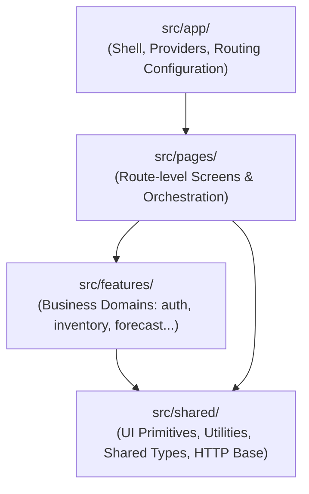

# Báo cáo Kiến trúc: Thiết lập Nền tảng Dự án ShelfCash FE v2

---

## Thông tin Báo cáo (Report Metadata)

| Trường thông tin | Giá trị |
| :--- | :--- |
| **Số thứ tự (ID)** | `#001` |
| **Tiêu đề** | Thiết lập nền tảng dự án & Định hướng kiến trúc tổng thể (Architecture Foundation) |
| **Ngày tạo lập** | 05/10/2026 |
| **Tác giả / Vai trò** | Pair Programming AI Assistant (Antigravity) & Lead Engineer |
| **Trạng thái** | Đã nghiệm thu (Accepted) |

---

## 1. General Context (Bối cảnh Tổng quan)

Dự án **ShelfCash Frontend (v2)** là phiên bản làm mới hoàn toàn (rebuild from scratch) của hệ thống ShelfCash, bắt đầu từ một repository trống. 

Mục tiêu cốt lõi của giai đoạn này là:
1. **Thiết lập nền móng kỹ thuật chuẩn xác, tinh gọn**: Sử dụng React 19 + TypeScript + Vite, không mang theo các quyết định kiến trúc cũ mang tính nợ kỹ thuật (legacy technical debt).
2. **Tuân thủ triết lý tối giản (Anti-overengineering)**: Chỉ tạo những thành phần thực sự cần thiết cho yêu cầu hiện tại; không trừu tượng hóa sớm (no premature abstraction); tuyệt đối không cài đặt hàng loạt thư viện ngoại vi (Redux, Zustand, React Query, Axios, Tailwind, Component UI kits) khi chưa có bài toán cụ thể.
3. **Đáp ứng yêu cầu UI tối thiểu ban đầu**:
   - Header hiển thị chữ `ShelfCash` ở góc trên bên trái.
   - Nút `Đăng nhập` ở góc trên bên phải.
   - Căn chỉnh ngang, padding hợp lý, hỗ trợ responsive cơ bản.
   - Toàn bộ phần còn lại của màn hình để trống; không icon, không ảnh, không animation, không mock API hay logic xác thực giả.
4. **Mở đường cho kiến trúc module hóa tương lai**: Đảm bảo cấu trúc code sẵn sàng mở rộng sang các phân hệ nghiệp vụ phức tạp (Inventory, Forecasting, Procurement, v.v.) mà không cần đập đi xây lại.

---

## 2. Current Tech Stack (Công nghệ Hiện tại)

- **Framework / Core**: [React 19](https://react.dev/) (`react`, `react-dom`)
- **Ngôn ngữ**: [TypeScript](https://www.typescriptlang.org/) (Strict typing, Bundler resolution)
- **Công cụ Build & Dev Server**: [Vite 8](https://vite.dev/) (Cực nhanh, hỗ trợ HMR)
- **Styling**: Native Vanilla CSS ([`src/index.css`](../src/index.css))
- **Linter**: Oxlint (Kiểm tra quy tắc React & TypeScript với hiệu năng cao)

> **Ghi chú về Dependencies**: Repository duy trì tối giản tuyệt đối, chỉ gồm các phụ thuộc cơ bản của React và Vite. Không có bất kỳ thư viện quản lý state, HTTP client, hay UI library nào.

---

## 3. Current Directory Structure (Cấu trúc Thư mục Hiện tại)

```text
Shelfcash_FE_v2/
├── docs/
│   ├── README.md                          # Thư viện quản lý các báo cáo kiến trúc
│   └── 001-architecture-foundation.md     # Báo cáo #001 này
├── public/
│   └── favicon.svg                        # Favicon tối giản của ShelfCash
├── src/
│   ├── main.tsx                           # Điểm khởi chạy React ứng dụng
│   ├── App.tsx                            # Root component / màn hình hiện tại
│   ├── Header.tsx                         # Header tối giản chứa Brand và nút Đăng nhập
│   └── index.css                          # CSS reset và định kiểu cho Header & App
├── index.html                             # Template HTML gốc (<title>ShelfCash</title>)
├── package.json                           # Khai báo dependency và script thực thi
├── package-lock.json
├── tsconfig.json
├── tsconfig.app.json
├── tsconfig.node.json
├── vite.config.ts
└── README.md                              # Tài liệu hướng dẫn khởi chạy dự án
```

> **Đã dọn dẹp sạch sẽ**: Đã xóa toàn bộ tài nguyên mẫu mặc định sinh ra bởi Vite (`hero.png`, `react.svg`, `vite.svg`, `icons.svg`, `App.css`).

---

## 4. Architecture Direction (Định hướng Kiến trúc Dài hạn)

Dự án định hướng theo mô hình **Kiến trúc hướng tính năng (Feature-Driven / Modular Frontend Architecture)**, phân định rõ ràng 4 tầng trách nhiệm:



### Chi tiết phân chia trách nhiệm:

1. **`app/` (Application Shell & Infrastructure)**:
   - *Hiện tại:* Do [`src/main.tsx`](../src/main.tsx) và [`src/App.tsx`](../src/App.tsx) trực tiếp đảm nhận.
   - *Tương lai:* Quản lý cấu hình root route, các Global Providers (nếu có), Layout shell bao ngoài (AppLayout).

2. **`pages/` (Màn hình mức Route)**:
   - *Hiện tại:* Đại diện bởi giao diện duy nhất trong [`src/App.tsx`](../src/App.tsx).
   - *Tương lai:* Chứa các component màn hình tương ứng với từng URL route (ví dụ `LoginPage`, `InventoryPage`, `DashboardPage`). Màn hình chỉ đóng vai trò kết nối (orchestrator), lấy param từ URL và ghép các component từ `features/`, không chứa logic nghiệp vụ phức tạp.

3. **`features/` (Phân hệ Nghiệp vụ Độc lập)**:
   - *Hiện tại:* Chưa tạo để tránh tạo thư mục rỗng khi chưa có code.
   - *Tương lai:* Mỗi nghiệp vụ sẽ là một module tự đóng gói (self-contained) bao gồm: components, hooks, api client, types, state nội bộ.

4. **`shared/` (Tài nguyên Dùng chung)**:
   - *Hiện tại:* Được xử lý qua CSS gốc và component [`src/Header.tsx`](../src/Header.tsx).
   - *Tương lai:* Chứa các UI Primitives không phụ thuộc nghiệp vụ (Button, Input, Modal, Table), các hàm utility, format date/currency, cấu hình base HTTP client.

---

## 5. Quy hoạch Vị trí các Phân hệ Tương lai (Future Modules)

Khi phát triển thêm tính năng, code sẽ được đưa vào các thư mục tương ứng trong `src/features/`:

| Phân hệ (Module) | Đường dẫn dự kiến | Phạm vi trách nhiệm |
| :--- | :--- | :--- |
| **Authentication** | `src/features/auth/` | Form đăng nhập/đăng xuất, token storage, user profile, auth guards |
| **Dashboard** | `src/features/dashboard/` | Widget tổng quan, KPI metrics, biểu đồ tóm tắt hiệu suất |
| **Inventory** | `src/features/inventory/` | Danh mục hàng tồn, SKU, số lượng theo kho, điều chỉnh tồn kho |
| **Forecasting** | `src/features/forecasting/` | Biểu đồ dự báo nhu cầu, phân tích xu hướng bán hàng, dự đoán theo mùa |
| **Decision Planning** | `src/features/decision-planning/`| Đề xuất nhập hàng, kế hoạch đặt hàng tự động, mô phỏng ngân sách |
| **Procurement** | `src/features/procurement/` | Đơn đặt hàng (PO), quản lý nhà cung cấp, tiến độ giao hàng |

---

## 6. What NOT to add yet (Những hạng mục chủ động hoãn lại)

Để bảo đảm tính đơn giản và tránh nợ kỹ thuật từ sớm, các hạng mục sau **chưa được thêm vào**:
- **Global State Management (Redux, Zustand, Jotai)**: Chưa có nhu cầu chia sẻ state liên màn hình.
- **Tầng trừu tượng API / Mock Backend (Axios, React Query, Mirage, MSW)**: Chưa kết nối backend thực tế; không tạo service giả hay contract phỏng đoán.
- **Hệ thống Routing phức tạp**: Hiện tại app chỉ có 1 view, chỉ bổ sung Router khi có màn hình thứ 2.
- **Design System / Token System / Tailwind**: Đang sử dụng CSS tinh gọn; hệ thống design token sẽ chỉ hình thành khi UI guideline hoàn thiện.
- **Component UI Kit (Ant Design, MUI, Shadcn)**: Tránh làm phình bundle size và ràng buộc giao diện vào thư viện bên ngoài.

---

## 7. Next Architectural Milestone (Cột mốc Kiến trúc Tiếp theo)

Khi bước sang giai đoạn phát triển màn hình tiếp theo:
1. **Thiết lập Routing cơ bản**: Tích hợp routing gọn nhẹ (ví dụ `react-router`) khi xây dựng màn hình Đăng nhập (`/login`).
2. **Chuyển giao cấu trúc thư mục**: Di chuyển `App.tsx` vào `src/app/App.tsx`, tạo màn hình đầu tiên trong `src/pages/LandingPage.tsx` hoặc `src/pages/LoginPage.tsx`.
3. **Khởi tạo module nghiệp vụ đầu tiên**: Xây dựng `src/features/auth/` với form đăng nhập và xử lý xác thực.

---

## 8. Kết quả Xác minh Kỹ thuật (Validation)

- **Build Check**: `npm run build` (`tsc -b && vite build`) hoàn thành thành công (**0 lỗi**).
- **Linter Check**: `npm run lint` (`oxlint`) quét qua toàn bộ file (**0 cảnh báo, 0 lỗi**).
- **Dev Server**: Khởi chạy thành công trên `http://localhost:5173/` với HMR.
- **Layout & Responsive**: Header hiển thị chuẩn `ShelfCash` bên trái, `Đăng nhập` bên phải, căn giữa theo chiều dọc, responsive thu nhỏ padding trên thiết bị di động (`max-width: 480px`).
